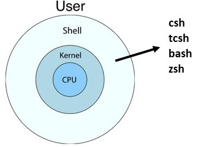
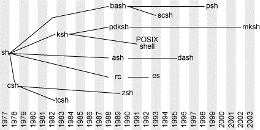

# Unix Shells

A **shell** is a command-line interface (CLI) that allows users to interact with the operating system. It acts as an intermediary between the user and the **kernel** — interpreting the commands you type and executing them on your behalf.

Think of the shell as a translator: you speak in human-readable commands, and the shell converts them into instructions the operating system can understand.



## Unix Shell History

Over the decades, many shells have been developed — each improving on the previous generation. The timeline below shows the major shells and how they relate to one another.



**C Shell (`csh`) — 1978**

Developed by Bill Joy at UC Berkeley. Its syntax was inspired by the C programming language, making it familiar to C programmers. It introduced features like built-in command history, aliases, and job control. However, `csh` has well-known scripting flaws — poor error handling, inconsistent quoting rules, and lack of functions — famously documented in Tom Christiansen's essay *"Csh Programming Considered Harmful"*.

> **Current usage:** Largely superseded by `tcsh` for interactive use and by `sh`/`bash` for scripting. Today `csh` is mostly found in legacy BSD environments and some older scientific computing setups.

**Bourne Shell (`sh`) — 1979**

Developed by Stephen Bourne at Bell Labs. One of the earliest and most influential shells, it became the default shell on early Unix systems. It is minimal and highly portable, but lacks modern conveniences like command history and command-line editing.

> **Current usage:** The original `sh` binary is rarely used directly on modern systems. Instead, `/bin/sh` is typically a symbolic link to a POSIX-compliant shell such as `dash` or `bash`. However, the Bourne Shell's syntax lives on as the foundation of the POSIX shell standard, and portable shell scripts are still written to target `sh` compatibility.

**Tenex C Shell (`tcsh`) — 1981**

An enhanced version of the C Shell that is fully backward compatible with `csh`. It added improved history navigation and command-line completion. The name "Tenex" comes from the TENEX operating system that inspired the completion feature.

> **Current usage:** Was the default interactive shell on FreeBSD (for regular users, until FreeBSD 14 in 2023) and was popular in academic and scientific computing. It has largely been replaced by `bash` and `zsh` on most platforms. It inherits the same scripting limitations as `csh`, so it is mainly used for interactive work in legacy environments.

**Korn Shell (`ksh`) — 1983**

Developed by David Korn at Bell Labs. It combines the best features of both the Bourne Shell and the C Shell — offering powerful scripting capabilities along with interactive conveniences like built-in arithmetic and command history.

> **Current usage:** Was the dominant shell on commercial Unix systems such as IBM AIX, HP-UX, and Solaris, where many existing system scripts still depend on it. AT&T initially kept `ksh` proprietary, which limited its adoption on free and open-source systems. By the time `ksh93` was open-sourced (2000), `bash` had already become the Linux standard. A lightweight variant called `mksh` (MirBSD Korn Shell) is used as the default shell in Android (AOSP).

**Almquist Shell (`ash`) — 1989**

Developed by Kenneth Almquist. A lightweight, POSIX-compliant shell designed for minimal environments. It intentionally omits interactive features like tab completion and command history to keep its footprint small.

> **Current usage:** Commonly used in embedded Linux systems, routers, IoT devices, and Docker Alpine images through BusyBox, which bundles `ash` as its shell. It is not intended for interactive use — its role is to provide a fast, minimal POSIX shell where resources are constrained.

**Bourne Again Shell (`bash`) — 1989**

Developed as part of the GNU Project as a free replacement for the Bourne Shell. It includes all the features of `sh` plus many enhancements: command-line editing, history, auto-completion, and improved scripting capabilities. `bash` is the primary focus of this primer.

> **Current usage:** The **default shell on most Linux distributions** and the dominant shell for scripting, CI/CD pipelines, and DevOps tooling. It was also the default shell on macOS until Catalina (2019), when Apple switched to `zsh` due to `bash`'s GPLv3 license.

**Z Shell (`zsh`) — 1990**

A highly customizable and user-friendly shell that combines features from `bash`, `ksh`, and `tcsh`. It offers spell correction, advanced tab completion, and theme support.

> **Current usage:** Has gained wide popularity through frameworks like **Oh My Zsh** and became the default shell on macOS starting with Catalina (2019). Increasingly popular among developers for interactive use, but `bash` still dominates in scripting and server environments due to its ubiquity and long-established ecosystem.

**Debian Almquist Shell (`dash`) — 2002**

Derived from `ash` by the Debian project. It is a fast, lightweight, POSIX-compliant shell designed for efficiency.

> **Current usage:** Commonly used as the default `/bin/sh` on Debian-based systems (including Ubuntu) to speed up system boot scripts. Not intended for interactive use — it lacks tab completion, command history, and prompt customization. Its sole purpose is to execute POSIX shell scripts as quickly as possible.

**Friendly Interactive Shell (`fish`) — 2005**

Designed with ease of use as a primary goal. It provides syntax highlighting, autosuggestions, and a clean scripting language out of the box. `fish` deliberately does not comply with POSIX standards — its syntax is intentionally different to be more user-friendly.

> **Current usage:** Popular among developers who prioritize a pleasant interactive experience over POSIX compatibility. Scripts written for `sh` or `bash` will not work in `fish`, and `fish` scripts are not portable to other shells, which limits its adoption for scripting.

**Restricted Shell (`rbash`)**

Not a separate shell — it is `bash` launched in restricted mode. It limits what the user can do (e.g., changing directories, modifying `PATH`, using redirection).

> **Current usage:** Used for security and access-control purposes in shared hosting environments, kiosk systems, and restricted service accounts where users need shell access but should not have full system control.

## Available Shells (Ubuntu)

The `/etc/shells` file lists all the shell programs installed and available on your system:

    $ cat /etc/shells

    /bin/sh
    /bin/bash
    /usr/bin/bash
    /bin/rbash
    /usr/bin/rbash
    /bin/dash
    /usr/bin/dash

Each line is the path to a shell executable. Note that some entries are **symbolic links** to another shell. You can use `readlink -f` to resolve the full symlink chain to the final binary. The following script checks every entry in `/etc/shells`:

```bash
while read -r shell; do
    [[ "$shell" =~ ^# ]] || [[ -z "$shell" ]] && continue
    if [ -L "$shell" ]; then
        echo "$shell -> $(readlink -f "$shell") (symlink)"
    else
        echo "$shell (binary)"
    fi
done < /etc/shells
```

Output:

    /bin/sh -> /usr/bin/dash (symlink)
    /bin/bash (binary)
    /usr/bin/bash (binary)
    /bin/rbash -> /usr/bin/bash (symlink)
    /usr/bin/rbash -> /usr/bin/bash (symlink)
    /bin/dash (binary)
    /usr/bin/dash (binary)

For example, `/bin/rbash` is a symbolic link to `bash` (bash runs in restricted mode when invoked as `rbash`):

    $ ls -l /bin/rbash
    lrwxrwxrwx 1 root root 4 Dec  1 12:13 /bin/rbash -> bash

Another notable link: `/bin/sh` points to `dash`, not `bash`:

    $ ls -l /bin/sh
    lrwxrwxrwx 1 root root 4 Dec  1 12:13 /bin/sh -> dash

Historically, `/bin/sh` was linked to `bash`. Starting with Ubuntu 6.10, it was changed to `dash`. The reason is performance — during boot, many shell scripts run via `/bin/sh`. Since `dash` is lighter and faster than `bash`, using it significantly reduces boot time.

## New Users and Shell

A **login shell** is the first shell session that starts when a user logs into the system. For a detailed explanation of login shells, interactive shells, and other shell types, see [Shell Types](04_shell_type.md).

When creating a new user, you can specify their login shell with the `-s` (or `--shell`) option:

    $ sudo useradd -s /bin/bash username

If no shell is specified, the system assigns the default shell defined in `/etc/default/useradd`:

    $ cat /etc/default/useradd | grep SHELL=
    SHELL=/bin/sh

## Get Current Shell

The `$SHELL` environment variable stores the login shell for the current user:

    $ echo $SHELL
    /bin/bash

You can also check the shell assigned to any user by looking at the `/etc/passwd` file (the shell is the last field on each line):

    $ cat /etc/passwd

    <snip>
        maniam:x:1000:1000:maniam,,,:/home/maniam:/bin/bash
    <snip>

To list the shell for every user on the system:

    $ cat /etc/passwd | awk -F: '{print $1, $7}'

## Switching Shells

**Temporarily** — type the name of the shell you want to switch to. The current shell finds and launches it as a child process:

    maniam@jupyter:~$ sh
    $

Type `exit` to return to your previous shell.

**Permanently** — use the `chsh` command to change your default login shell:

    $ chsh -s /bin/zsh

This updates `/etc/passwd` and takes effect on your next login.

## Preventing User Login

Most system accounts are assigned `/usr/sbin/nologin` or `/bin/false` instead of a real shell. Both prevent interactive login, but they work differently.

**`/usr/sbin/nologin`**

When assigned as a user's shell, `nologin` displays a message and immediately terminates the session. The user sees:

    This account is currently not available.

This message can be customized via `/etc/nologin.txt`.

**`/bin/false`**

`/bin/false` is even simpler — it does nothing except exit with a failure status (exit code 1). There is no message, no feedback. The login attempt silently fails.

| Feature              | `/usr/sbin/nologin`              | `/bin/false`                  |
|----------------------|----------------------------------|-------------------------------|
| Shows a message      | Yes ("account not available")    | No (silent failure)           |
| Exit code            | 1                                | 1                             |
| Customizable message | Yes (`/etc/nologin.txt`)         | No                            |
| Typical use          | System service accounts          | Accounts that should never have any shell access |

**Common use cases:**

- **System accounts** — Accounts like `daemon`, `bin`, and `mail` run background services and never need interactive login. Assigning `nologin` as their shell ensures they cannot be used to log in, while their services continue to function normally.

- **Application accounts** — Some applications (e.g., `redis`) use `/bin/false` because they are managed entirely by their own service and should never run any shell at all.

- **Temporarily disabling a user** — To lock an account without deleting it, change the shell to `nologin`:

      $ sudo usermod -s /usr/sbin/nologin username

---

[Next: Shell Config →](02_shell_config.md)
