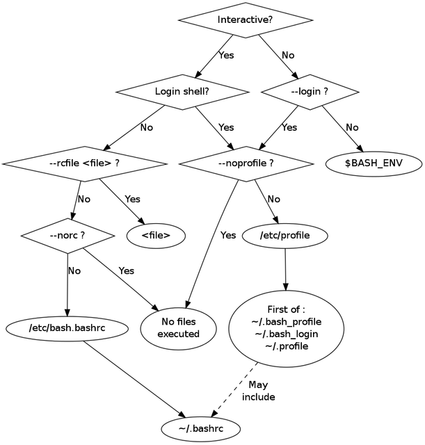

# Shell Configuration Files

Shell configuration files are scripts that a shell reads and executes during startup. They set up the environment, define default behaviors, and apply user preferences — typically through environment variable definitions, aliases, functions, and other settings.

A few important points to keep in mind:

- Different shells use **different file names and locations** for their configuration.

- The **order** in which configuration files are sourced depends on whether the shell is a login shell, an interactive shell, or both.

- The **syntax** for setting variables, defining aliases, or writing functions can differ across shells. For example, Fish does not follow POSIX shell syntax, unlike Bash or Zsh.

## Configuration Files by Shell

The table below shows which configuration files each major shell reads, and when:

| File Path                          | sh   | ksh  | csh  | tcsh  | bash         | zsh   |
|------------------------------------|------|------|------|-------|--------------|-------|
| `/etc/.login`                      |      |      | login| login |              |       |
| `/etc/csh.cshrc`                   |      |      | yes  | yes   |              |       |
| `/etc/csh.login`                   |      |      | login| login |              |       |
| `~/.tcshrc`                        |      |      |      | yes   |              |       |
| `~/.cshrc`                         |      |      | yes  | yes   |              |       |
| `$ENV` (typically `~/.kshrc`)      |      | yes  |      |       |              |       |
| `~/.login`                         |      |      | login| login |              |       |
| `~/.logout`                        |      |      | login| login |              |       |
| `/etc/profile`                     | login| login|      |       | login        | login |
| `~/.profile`                       | login| login|      |       | login        | login |
| `~/.bash_profile`                  |      |      |      |       | login        |       |
| `~/.bash_login`                    |      |      |      |       | login        |       |
| `~/.bash_logout`                   |      |      |      |       | login        |       |
| `~/.bashrc`                        |      |      |      |       | int.+n/login |       |
| `/etc/zshenv`                      |      |      |      |       |              | yes   |
| `/etc/zprofile`                    |      |      |      |       |              | login |
| `/etc/zshrc`                       |      |      |      |       |              | int.  |
| `/etc/zlogin`                      |      |      |      |       |              | login |
| `/etc/zlogout`                     |      |      |      |       |              | login |
| `~/.zshenv`                        |      |      |      |       |              | yes   |
| `~/.zprofile`                      |      |      |      |       |              | login |
| `~/.zshrc`                         |      |      |      |       |              | int.  |
| `~/.zlogin`                        |      |      |      |       |              | login |

**Legend:**

- **yes** — the file is always read when the shell starts.
- **login** — the file is read only when the shell is a login shell.
- **n/login** — the file is read only when the shell is *not* a login shell.
- **int.** — the file is read only when the shell is interactive.
- **int.+n/login** — the file is read when the shell is both interactive *and* not a login shell.

> For a detailed explanation of login shells, interactive shells, and other shell types, see [Shell Types](04_shell_type.md).

## Bash Configuration Files

Since this primer focuses on Bash, here is a closer look at the files Bash reads during startup:

| File                 | Purpose                                  | When It Is Read                    |
|----------------------|------------------------------------------|------------------------------------|
| **`/etc/profile`**   | **System-wide environment setup**        | **Login shells**                   |
| **`~/.bash_profile`**| **User-specific login shell setup**      | **Login shells**                   |
| **`~/.bash_login`**  | **Fallback if `~/.bash_profile` is missing** | **Login shells**               |
| **`~/.profile`**     | **Generic login setup (shared with `sh`)** | **Login shells (fallback)**      |
| `~/.bash_logout`     | Cleanup commands run on logout           | Exiting login shells               |
| `~/.bashrc`          | User-specific interactive shell setup    | Interactive non-login shells       |
| `/etc/bash.bashrc`   | System-wide interactive shell setup      | Non-login shells (on some systems) |

> Files that start with `bash` in their name belong exclusively to Bash. The remaining files — `/etc/profile` and `~/.profile` — are originally `sh` files. Bash reads them for backward compatibility.

The following flowchart shows the order in which Bash reads its configuration files:



The most common path through this flowchart is the **login shell** path. When Bash starts as a login shell, it reads:

1. System-wide: `/etc/profile`
2. User-specific: the **first one found** among `~/.bash_profile`, `~/.bash_login`, or `~/.profile` — the remaining files are skipped.

Login shells, interactive shells, and how they differ are covered in detail in [Shell Types](04_shell_type.md).

## `/etc/environment` File

`/etc/environment` is a system-wide configuration file found on Linux systems. Unlike `~/.bashrc` or `~/.profile`, it is **not a shell script** — it is a plain key-value file where each line assigns a single variable:

```bash
PATH="/usr/local/bin:/usr/bin:/bin"
LANG="en_US.UTF-8"
LC_ALL="en_US.UTF-8"
MY_CUSTOM_VAR="custom_value"
```

Key characteristics:

- **No variable expansion.** References like `$HOME` are not resolved. You must provide explicit values (full paths, literal strings).
- **Read by PAM, not the shell.** When a user logs in, the PAM (Pluggable Authentication Module) subsystem reads `/etc/environment` and applies the variables to the session. This means the variables are available regardless of which shell — or even if no shell — is used.
- **Available to all sessions.** System services, graphical applications, and terminal sessions all inherit these variables.

Use `/etc/environment` when you need to set environment variables that apply system-wide and are not specific to any particular shell. Common examples include:

- Setting the default `LANG` and locale.
- Defining global entries in `PATH`.

---

[← Previous: Introduction](01_introduction.md) | [Next: Bash →](03_bash.md)
