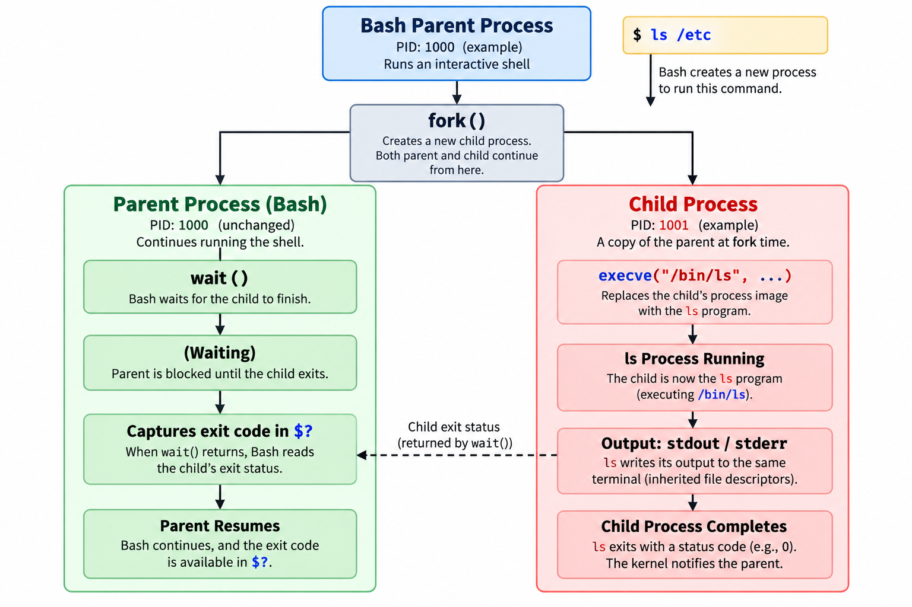

# Command Execution

The most straightforward way to execute a command in Bash is to type the command and press Enter. Bash handles all the underlying process management automatically.

## How Bash Runs a Command

When you type a command such as `ls -l /var/log`, Bash goes through a series of steps:

1. **Locates the command** — Bash searches the directories listed in the `$PATH` environment variable to find the executable (see [PATH](11_path_env_variable.md)).
2. **Spawns a new process** — Bash creates a **child process** using the `fork()` system call.
3. **Replaces the child with the command** — The child process calls `execve()` to load and run the actual program (e.g., `/bin/ls`).
4. **Waits for completion** — The parent Bash process calls `wait()` and remains idle until the child finishes.
5. **Captures the exit status** — When the child exits, its exit code is stored in the special variable `$?` (see [Exit Status](27_exit_status.md)).

```bash
ls -l /var/log
echo $?    # 0 if the command succeeded
```

The command's standard output (`stdout`) and error messages (`stderr`) are both displayed in the terminal by default. You can redirect them as needed (see [Redirection](31_redirection.md)).

## The Fork-Exec Model

Bash uses the **fork-exec** model — the standard Unix mechanism for running programs.

### `fork()`

The `fork()` system call creates a new child process that is a duplicate of the parent (the Bash shell itself). At this point, two nearly identical processes exist.

### `execve()`

The child process then calls `execve()`, which:

- Replaces the child's memory image with the target program (e.g., `ls`).
- Loads the program's executable into memory.
- Begins executing the program's code.

After `execve()`, the child is no longer a copy of Bash — it is now the `ls` process.

### `wait()`

The parent Bash process calls `wait()` to pause until the child finishes. Once the child exits, Bash reads its exit code and resumes control.

### Inherited File Descriptors

The child process inherits `stdin`, `stdout`, and `stderr` from the parent Bash process. This is why the command's output appears in the same terminal.

### Process Flow Diagram



## Orphan and Zombie Processes

Under normal circumstances, the parent Bash process waits for its child to finish, reads its exit status, cleans up, and resumes. Two edge cases can arise when this normal flow is disrupted.

### Orphan Process

An **orphan process** occurs when the parent terminates before its child finishes:

```bash
sleep 300 &   # Start a long-running background job
exit          # Exit the shell (parent)
```

The `sleep` process continues running even though its parent shell is gone. The operating system reassigns the orphaned child to the **init** process (PID 1) or **systemd**, which becomes responsible for monitoring and cleaning up the child's exit status.

### Zombie (Defunct) Process

A **zombie process** is one that has finished executing but still occupies an entry in the **process table** because its parent has not yet read its exit status:

- The child process has exited — it is no longer running.
- The kernel keeps a small record (PID and exit code) so the parent can call `wait()` to retrieve the status.
- Once the parent collects this information, the kernel removes the zombie entry.

A zombie consumes no CPU or memory — only a process-table slot. It disappears as soon as the parent reaps it.

### Quick Summary

| Scenario   | What Happens                                   | Resolution |
|------------|------------------------------------------------|------------|
| **Normal** | Parent waits for the child and cleans up       | Standard flow |
| **Orphan** | Parent exits first; child keeps running        | Adopted by PID 1 |
| **Zombie** | Child exits first; parent hasn't reaped it yet | Parent calls `wait()` |

## `timeout` Command

`timeout` runs a command with a time limit. If the command does not finish within the specified duration, `timeout` terminates it.

This is useful for managing long-running or potentially hanging processes.

```bash
timeout 10s <command>
```

### Time Units

| Suffix | Meaning                | Example |
|--------|------------------------|---------|
| `s`    | Seconds (default unit) | `10s`   |
| `m`    | Minutes                | `2m`    |
| `h`    | Hours                  | `1h`    |
| `d`    | Days                   | `3d`    |

If no suffix is provided, the value is interpreted as seconds:

```bash
timeout 10 some_command    # 10 seconds
```

### Exit Code

You can check whether the command timed out by inspecting `$?`:

- **124** — The command timed out.
- **0** — The command completed successfully.
- **Other** — An error from the command itself.

```bash
timeout 3s sleep 5
exit_code=$?

if [ $exit_code -eq 124 ]; then
    echo "The command timed out"
elif [ $exit_code -eq 0 ]; then
    echo "The command completed successfully"
else
    echo "The command failed with exit code: $exit_code"
fi
```

> `$?` is updated after **every** command — including the `[` test itself. Saving it to a variable ensures the original exit code is not lost in an `if/elif` chain. See [Exit Status — Checking the Exit Status](27_exit_status.md#checking-the-exit-status) for a detailed explanation.

### Signal Handling

By default, `timeout` sends `SIGTERM` to stop the process gracefully. If the process does not terminate, you can use the `-k` option to send `SIGKILL` after a grace period:

```bash
timeout -k 2s 5s some_command
```

This sends `SIGTERM` after 5 seconds, then `SIGKILL` 2 seconds later if the process is still running.

You can also specify a different initial signal with the `--signal` option:

```bash
timeout --signal=SIGKILL 10s sleep 30
```

## `eval` Command

`eval` takes a string, parses it as a Bash command, and executes it:

```bash
command="ls -l /path/to/dir"
eval "$command"
```

> **Caution:** Avoid using `eval` when possible. It can introduce security risks such as **command injection**, especially when the string contains user-supplied input.

---

[← Previous: Exit Status](27_exit_status.md) | [Next: Command Substitution →](29_command_substitution.md)
