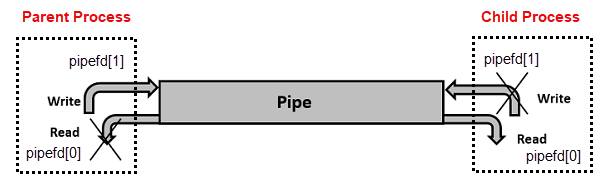

# Command Chaining

Command chaining lets you combine multiple commands on a single line, controlling whether they run sequentially, conditionally, or as a pipeline.

| **Operator** | **Name**        | **Description**                                                           |
|--------------|-----------------|---------------------------------------------------------------------------|
| `;`          | Semicolon       | Runs commands one after another, regardless of success or failure.        |
| `&&`         | Logical AND     | Runs the next command only if the previous one succeeded (exit status 0). |
| `\|\|`       | Logical OR      | Runs the next command only if the previous one failed (non-zero status).  |
| `\|`         | Pipe            | Passes the stdout of one command as stdin to the next.                    |
| `\|&`        | Pipe (with err) | Passes both stdout and stderr to the next command.                        |

## Semicolon `;`

Runs commands sequentially, regardless of whether the previous command succeeds or fails:

```bash
echo "First command"; echo "Second command"
```

Both commands always run. The exit status of the chain is the exit status of the **last** command.

## Logical AND `&&`

Runs the next command only if the previous one succeeds (exit status 0). For details on exit codes, see [Exit Status](27_exit_status.md).

```bash
mkdir my_dir && echo "Directory created successfully"
```

If `mkdir` fails, `echo` is skipped.

## Logical OR `||`

Runs the next command only if the previous one fails (non-zero exit status):

```bash
mkdir my_dir || echo "Failed to create directory"
```

If `mkdir` succeeds, `echo` is skipped.

## Combining `&&` and `||`

You can combine both operators to run one command on success and another on failure:

```bash
mkdir my_dir && echo "Success" || echo "Failure"
```

```bash
[[ -f file.txt ]] && echo "File exists" || echo "File does not exist"
```

### Precedence and Evaluation Order

In Bash command lists, `&&` and `||` have **equal precedence** and are evaluated **left to right**. This means chains are grouped from left to right, just like reading a sentence.

The example above is parsed as:

```bash
( mkdir my_dir && echo "Success" ) || echo "Failure"
```

This works as expected: if `mkdir` succeeds, `echo "Success"` runs (and `echo "Failure"` is skipped because the `||` left side succeeded). If `mkdir` fails, `echo "Success"` is skipped, the `&&` result is failure, so `echo "Failure"` runs.

Here is another example that checks whether a directory exists, creates it if necessary, and then archives it:

```bash
[ -d logs ] || mkdir logs && tar -czf logs.tar.gz logs
```

Because evaluation is left to right, this is parsed as:

```bash
( [ -d logs ] || mkdir logs ) && tar -czf logs.tar.gz logs
```

- If `logs/` exists, `[ -d logs ]` succeeds → `||` short-circuits (skips `mkdir`) → result is success → `&&` runs `tar`.
- If `logs/` does not exist, `[ -d logs ]` fails → `||` runs `mkdir logs` → if `mkdir` succeeds → `&&` runs `tar`.
- If both `[ -d logs ]` and `mkdir` fail → `&&` skips `tar`.

> **Tip:** For complex logic, use an explicit `if…else` block instead of long `&&`/`||` chains. It is easier to read and less error-prone. See [Conditional Statements](22_conditional.md).

## Pipeline `|`

A pipeline passes the stdout of one command as stdin to the next command:

```bash
echo "Hello World" | grep "World"
```

### Common Pipeline Patterns

Count lines in a file:

```bash
cat file.txt | wc -l
```

Find a keyword and count its occurrences:

```bash
cat file.txt | grep "keyword" | wc -l
```

List only filenames from `ls -l`:

```bash
ls -l | awk '{print $9}'
```

List file sizes for all `.log` files:

```bash
find . -name "*.log" | xargs du -h
```

Show the 10 largest files in the current directory tree:

```bash
du -ah . | sort -rh | head -n 10
```

### Piping stderr

By default, a pipe passes only stdout. Error messages (stderr) are **not** included — they still print to the terminal.

To pass both stdout and stderr to the next command, use `|&`:

```bash
ls /valid/path /invalid/path |& grep "file"
```

`|&` is shorthand for `2>&1 |`:

```bash
ls /valid/path /invalid/path 2>&1 | grep "file"
```

For more on redirecting stderr, see [Redirection](31_redirection.md).

### How Pipes Work (OS Level)

When you use `|`, the shell asks the operating system to create a **pipe** — a small buffer in memory that connects the output of one process to the input of another. Internally, the shell calls the `pipe()` system call, which creates a pair of connected file descriptors:

- **Write end** — the parent process writes its output here.
- **Read end** — the child process reads input from here.



Pipes created by `|` only work between processes that share a parent-child relationship. Communication flows in **one direction** — one process writes and the other reads, but not both at the same time.

Pipes are one form of **Inter-Process Communication (IPC)**. Other IPC mechanisms include named pipes, shared memory, sockets, and message queues, but these are outside the scope of this document. Signals — another form of IPC — are covered in [SIGHUP](33_background_sighup.md) and [`trap`](38_trap.md).

### Pipe Buffer Size

The amount of data a pipe can hold at one time is determined by the **pipe buffer size**, which is set by the operating system, not Bash.

- On most Linux systems, the default buffer size is **64 KB** (65,536 bytes).
- You can check the maximum pipe size with:

    ```bash
    cat /proc/sys/fs/pipe-max-size
    ```

- If the buffer becomes full, the writing process **blocks** until the reading process consumes some data. This prevents data loss but creates a dependency between the two processes.
- Large data streams are processed in chunks, so data larger than the buffer size is handled automatically — it just flows through in pieces.

---

[← Previous: Command Substitution](29_command_substitution.md) | [Next: Redirection →](31_redirection.md)
