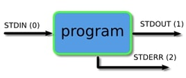

# Redirection

Every program in Linux has three standard I/O streams, identified by **file descriptors** (FDs):

| FD  | Name   | Purpose          | Default Connection    |
|-----|--------|------------------|-----------------------|
| `0` | stdin  | Standard input   | Keyboard (source)     |
| `1` | stdout | Standard output  | Terminal (target)     |
| `2` | stderr | Standard error   | Terminal (target)     |

By default, a program reads input from the keyboard (stdin), prints normal output to the terminal (stdout), and prints error messages to the terminal as well (stderr). The two output streams look the same on screen, but they are separate channels — this separation lets you handle normal output and errors independently.



**Redirection** lets you change this default flow. Instead of the keyboard and terminal, you can read input from a file, write output to a file, or even discard it entirely.

## Output Redirection: Overwriting Files

These operators write output to a file. If the file exists, its contents are replaced. If it does not exist, a new file is created.

| **Operator**   | **Description**                                         | **Example**                                   |
|----------------|---------------------------------------------------------|-----------------------------------------------|
| `>` or `1>`    | Redirect stdout to a file (overwrite).                  | `ls > filelist.txt`                           |
| `2>`           | Redirect stderr to a file (overwrite).                  | `ls bad_path 2> errors.txt`                   |
| `2>&1`         | Redirect stderr to wherever stdout is going.            | `command > output.txt 2>&1`                   |
| `&>`           | Redirect both stdout and stderr to a file (overwrite).  | `command &> output.log`                       |

`>` and `1>` are identical — both redirect stdout (FD 1). The short form `>` is more common:

```bash
echo "Hello, World!" > output.txt
echo "Hello, World!" 1> output.txt   # same effect
```

### Redirecting Both Streams

The following redirects stdout to `output.txt`, then redirects stderr (`2`) to wherever stdout (`1`) is already going — so both streams end up in the same file:

```bash
command > output.txt 2>&1
```

`&>` is a Bash shorthand that does the same thing in a more compact form:

```bash
command &> output.txt
```

> **Tip:** `&>` is Bash-specific. For maximum portability with other Bourne-like shells (e.g., `sh`), use the longer `> output.txt 2>&1` form.

### Keeping Streams Separate

For easier debugging, send stdout and stderr to different files:

```bash
command > output.log 2> error.log
```

### Discarding Output with `/dev/null`

`/dev/null` is a special file that discards anything written to it. Redirect to it when you want to suppress output:

```bash
# Suppress stdout only
ls /some/directory > /dev/null

# Suppress stderr only
command 2> /dev/null

# Suppress both stdout and stderr
command > /dev/null 2>&1
```

### Combining Redirection with Pipes

You can use redirection and pipes together. In the following example, `grep` output is piped into `sort`, and the final result is written to a file:

```bash
grep "pattern" file.txt | sort > sorted_results.txt
```

## Output Redirection: Appending Files

These operators add output to the end of a file. If the file exists, new content is appended. If it does not exist, a new file is created.

| **Operator**   | **Description**                                         | **Example**                                   |
|----------------|---------------------------------------------------------|-----------------------------------------------|
| `>>` or `1>>`  | Redirect stdout to a file (append).                     | `echo "More data" >> filelist.txt`            |
| `2>>`          | Redirect stderr to a file (append).                     | `ls bad_path 2>> errors.txt`                  |
| `&>>`          | Redirect both stdout and stderr to a file (append).     | `command &>> output.log`                      |

```bash
echo "First line" > output.txt    # creates or overwrites the file
echo "Second line" >> output.txt  # appends to the file
```

> **Tip:** Use `>>` (append) instead of `>` (overwrite) unless you intentionally want to replace the file's contents.

## Input Redirection

Input redirection lets a command read from a file or an inline string instead of the keyboard.

| **Operator** | **Description**                          | **Example**                       |
|--------------|------------------------------------------|-----------------------------------|
| `<`          | Redirect stdin from a file.              | `wc -l < file.txt`                |
| `<<`         | Provide multi-line input (here document).| `cat << EOF`                      |
| `<<<`        | Provide a single string (here string).   | `sort <<< "banana apple cherry"`  |

```bash
# Count the number of lines in a file
wc -l < file.txt
```

You can also use `/dev/null` as an empty input source when a command requires stdin but you have nothing to feed it:

```bash
some_command < /dev/null
```

To suppress all three standard streams at once:

```bash
some_command > /dev/null 2>&1 < /dev/null
```

### Here Document (`<<`)

A **here document** (heredoc) lets you provide multi-line input directly inside a script, without needing a separate file. Everything between the opening delimiter and the closing delimiter is passed as stdin to the command.

Heredocs are most commonly used with `cat`. While `cat` normally reads from a file, when no file is given it reads from stdin instead — and `<< EOF` supplies that stdin inline:

```bash
cat << EOF
This is line 1
This is line 2
EOF
```

The delimiter can be any word (commonly `EOF` or `END`). The closing delimiter must appear on its own line, at the very start of the line — no leading spaces:

```bash
my_func() {
    cat << EOF
This is inside a function.
The closing EOF must be at column 0, even though the function body is indented.
EOF
}

my_func
```

Variables inside a heredoc are expanded by default:

```bash
NAME="Mani"

cat << EOF
Hello $NAME, welcome to heredocs!
EOF
```

To prevent variable expansion, quote the opening delimiter:

```bash
cat << 'EOF'
Hello $NAME, this will NOT expand.
EOF
```

### Here String (`<<<`)

A **here string** passes a single string as stdin to a command:

```bash
sort <<< "banana apple cherry"
```

## The `exec` Command

The `exec` built-in serves two distinct purposes depending on whether you pass it a command or not.

### Replacing the Current Shell

When called with a command, `exec` replaces the current shell process with that command. No new process is created — the shell itself becomes the new command:

```bash
exec ls -ltr
```

After `ls` finishes, the shell is gone. No further commands in the script (or session) will run, because the shell process no longer exists.

### Redirecting File Descriptors

When called without a command, `exec` redirects file descriptors for the remainder of the current shell session. The shell continues running, but the redirected streams stay in effect:

```bash
ls *.txt
# Output:
# declare_p.txt  declare.txt  myfile1.txt  myfile2.txt  myfile.txt

# Redirect all stdout to a file
exec 1> ls_out

# From this point, all stdout goes to ls_out instead of the terminal
ls *.txt

# Restore stdout back to the terminal
exec 1>/dev/tty
```

## Custom File Descriptors

You can open additional file descriptors (FDs 3–9 are commonly used) for temporary I/O channels. This is useful when you need to write to multiple files or preserve a stream while redirecting another.

```bash
exec 3> tempfile.log  # Open FD 3 for writing to tempfile.log
echo "Hello" >&3      # Write to tempfile.log via FD 3
exec 3>&-             # Close FD 3 when done
```

To inspect which file descriptors are open in the current shell:

```bash
ls -l /proc/$$/fd
```

Sample output:

    lrwx------ 1 user user 64 Dec 20 20:11 0 -> /dev/pts/15
    lrwx------ 1 user user 64 Dec 20 20:11 1 -> /dev/pts/15
    lrwx------ 1 user user 64 Dec 20 20:11 2 -> /dev/pts/15
    lrwx------ 1 user user 64 Dec 20 20:11 255 -> /dev/pts/15
    l-wx------ 1 user user 64 Dec 20 20:11 3 -> /home/user/tempfile.log

> **Note:** FD 255 is an internal Bash descriptor used to manage redirections and preserve terminal state. Most Linux systems allow up to 1024 open descriptors per process (adjustable with `ulimit -n`).

## `sudo` and Redirection

Redirection operators (`>`, `>>`, `2>`, etc.) are processed by the **shell**, not by `sudo`. This means `sudo` does not elevate the permissions of the redirection — only the command it directly precedes.

Consider writing to a root-owned file:

```bash
echo "test" > /etc/protected.txt
# bash: /etc/protected.txt: Permission denied
```

Adding `sudo` does not help, because the shell (running as your user) handles the `>` before `sudo echo` runs:

```bash
sudo echo "test" > /etc/protected.txt
# bash: /etc/protected.txt: Permission denied
```

### Solutions

Run the entire command in a root shell:

```bash
sudo bash -c 'echo "test" > /etc/protected.txt'
```

Use `tee` to write with elevated privileges (the `> /dev/null` suppresses the copy `tee` prints to stdout):

```bash
echo "test" | sudo tee /etc/protected.txt > /dev/null
```

Use a text editor with `sudo`:

```bash
sudo nano /etc/protected.txt
```

---

[← Previous: Command Chaining](30_command_chaining.md) | [Next: Background →](32_background.md)
