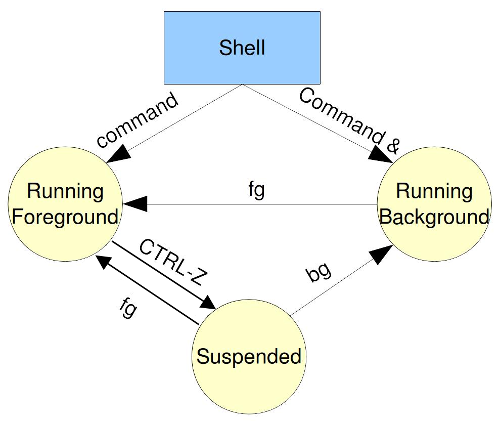

# Background Process

A **foreground** process occupies the terminal and blocks it until the process completes. A **background** process runs independently, freeing the terminal so you can continue working.

| **Aspect**            | **Foreground Process**              | **Background Process**        |
|-----------------------|-------------------------------------|-------------------------------|
| **Terminal Control**  | Blocks the terminal                 | Frees the terminal            |
| **User Interaction**  | Can take user input/output directly | Cannot interact directly      |

Background processes are useful for long-running tasks such as data analysis, backups, or downloads — you can start them and keep using the terminal for other work.

## Running a Process in the Background

To run a command in the background, append `&` at the end:

```bash
sleep 30 &
```

The shell prints two pieces of information:

    [1] 198133

- `[1]` is the **job number**, which identifies the process within the current shell session. You can use it to manage the job (covered later).
- `198133` is the **Process ID (PID)**, a unique identifier assigned by the operating system.

## Redirecting Background Output

By default, a background process still sends its output (stdout and stderr) to the terminal. This can be distracting, so you typically redirect or suppress it:

```bash
# Redirect stdout to a file
ls /var/log 1> output.log &

# Redirect stderr to a file
ls /var/log 2> error.log &

# Redirect both stdout and stderr to the same file
ls /var/log 1> output.log 2>&1 &

# Suppress all output
ls /var/log 1> /dev/null 2>&1 &
```

For a full explanation of redirection operators, see [Redirection](31_redirection.md).

## Conditional Background Execution

You can combine `&&` with `&` to start a background process only if a preceding command succeeds:

```bash
mkdir test_dir && sleep 5 &
```

Here, `sleep 5` runs in the background only if `mkdir test_dir` succeeds. If the directory creation fails, the background process never starts. For more on `&&`, see [Command Chaining](30_command_chaining.md).

## Accessing the Process ID

The special variable `$!` holds the PID of the most recently started background process:

```bash
sleep 10 &
echo "Background process PID: $!"

sleep 10 &
echo "Background process PID: $!"

sleep 10 &
echo "Background process PID: $!"
```

Each new background command updates `$!` automatically.

## `wait` Command

The `wait` command pauses the script until one or more background processes complete.

When given a PID, `wait` blocks until that specific process finishes and returns its exit status:

```bash
sleep 5 &
pid=$!
echo "Waiting for process $pid to complete..."
wait $pid
echo "Exit status of process $pid: $?"
```

When called without arguments, `wait` blocks until **all** background processes have finished:

```bash
sleep 5 &
sleep 10 &

echo "Waiting for all background processes to finish..."
wait
echo "All processes completed."
```

## `kill` Command

The `kill` command sends signals to processes, most commonly to terminate them. It is available as both a Bash built-in and an external binary:

    $ type -a kill
    kill is a shell builtin
    kill is /usr/bin/kill
    kill is /bin/kill

The built-in version allows **job IDs** (e.g., `%1`) to be used in place of PIDs, and it can still send signals even when the system's process limit has been reached.

The external binary comes from the `procps` package, which also provides `pkill` — a command that sends signals to processes matched by name or other attributes (e.g., user) rather than by PID.

### Sending Signals

You can use `kill` to send signals to background processes:

```bash
sleep 60 &
kill $!   # Kill the process by PID
```

By default, `kill` sends `SIGTERM` (signal 15), which requests a graceful termination. You can specify a different signal by name or number:

```bash
# Send a signal by name
kill -HUP <PID>

# Send a signal by number
kill -9 <PID>
```

### Common Signals

| Signal Name | Number | Description                                             |
|-------------|--------|---------------------------------------------------------|
| TERM        | 15     | Requests a graceful termination (default).              |
| KILL        | 9      | Forces immediate termination (cannot be caught).        |
| HUP         | 1      | Detach from terminal or request a configuration reload. |
| INT         | 2      | Interrupt signal, similar to pressing Ctrl+C.           |
| QUIT        | 3      | Causes the process to quit and generate a core dump.    |
| STOP        | 19     | Suspends the process (cannot be caught).                |
| CONT        | 18     | Resumes a suspended process.                            |

To see all available signals on your system:

```bash
kill -l
```

### Suspending and Resuming a Process

```bash
kill -STOP <PID>   # Suspend the process

kill -CONT <PID>   # Resume the process
```

## Jobs

In Bash, a **job** is a group of one or more processes started from the same command line and managed together by the current shell session.

For example:

```bash
$ sleep 30 &
[1] 4442
```

This creates a job with ID `[1]` containing one process (PID 4442).

A job can also contain multiple processes:

```bash
$ (sleep 5; echo "done") &
```

Here, the job contains two processes — one for `sleep` and one for `echo`.

- A **job** is a shell-level abstraction used for interactive control of foreground and background tasks.
- A **PID** is a kernel-level identifier for each individual process.

## Job Control

Job control lets you manage multiple processes within a single shell session — running them in the foreground or background, suspending them, and resuming them.

The following diagram summarizes the possible state transitions. A command starts as either a foreground or background job. From there, you can suspend, resume, or terminate it using the keyboard shortcuts and commands described below.



Start multiple background processes:

    $ sleep 30 &
    [1] 4442

    $ sleep 60 &
    [2] 4445

    $ sleep 90 &
    [3] 4448

    $ sleep 120 &
    [4] 4451

Use the `jobs` command to list all current jobs:

    $ jobs
    [1]   Running                 sleep 30 &
    [2]   Running                 sleep 60 &
    [3]-  Running                 sleep 90 &
    [4]+  Running                 sleep 120 &

- `[1]`, `[2]`, `[3]`, and `[4]` are job IDs.
- `+` marks the **current** (most recent) job — the default target for `fg` and `bg`.
- `-` marks the **previous** job.

### `fg` Command

Bring a background job to the foreground using `fg` followed by the job ID:

```bash
fg %1
```

### `bg` Command

When you suspend a foreground job by pressing **Ctrl+Z**, it pauses execution and appears in the job list as "Stopped":

```bash
$ sleep 100

^Z
[1]+  Stopped                 sleep 100
```

You can verify the status with `jobs`:

```bash
$ jobs
[1]+  Stopped                 sleep 100
```

Resume the suspended job in the background with `bg`:

```bash
$ bg %1
[1]+ sleep 100 &
```

---

[← Previous: Redirection](31_redirection.md) | [Next: SIGHUP →](33_background_sighup.md)
